<p align="center">
  
</p>

# review.nvim

Read GitLab merge requests and GitHub or Codeberg pull requests commit by commit,
view each file as an inline diff, and draft comments on a line or a line range
in Neovim.

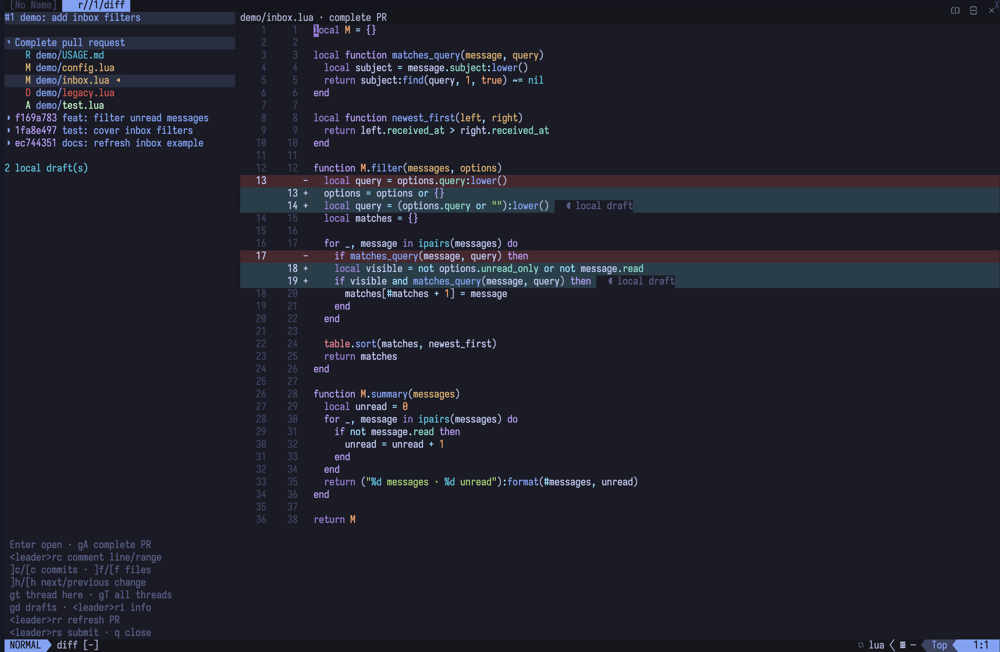

The tree groups changed files by directory. The sidebar shows the running
pipeline, reviewer decisions and two of five files viewed. `:ReviewViewed` and
`:ReviewUnviewed` update the local progress shown in the panel and diff title.

- Open a GitLab MR, GitHub PR or Codeberg PR URL, including commit/file subpages.
- Browse the exact commit list, oldest first.
- Read the MR/PR title and Markdown description.
- Switch between individual commits and the complete MR/PR.
- Read additions, deletions and context in one read-only buffer with both line numbers
  and intraline highlights.
- Filter changed files directly in the sidebar, or search them in Telescope.
- Browse changed files in a directory tree with collapsible folders.
- Mark files viewed or unviewed and keep local progress between sessions.
- See emoji reactions and counts on comments and replies.
- Select deleted lines as well as added lines.
- Save, edit and delete persistent local comment drafts.
- Draft replies to existing GitLab and GitHub discussions from their diff lines.
- Preview and explicitly publish drafts as inline discussions on GitLab, GitHub
  or Codeberg.
- See the latest pipeline/check status and reviewer decisions in the panel.
- Browse GitLab MR pipelines and their jobs in Telescope.
- Search review commands and configured shortcuts in Telescope.
- Approve the open MR/PR or request changes with explicit commands.
- Resolve a GitLab conversation, or confirm resolving all open MR conversations.
- Open the discussion under the cursor or browse all review discussions.
- Toggle discussion messages and replies directly below their commented lines.
- Jump from a discussion to its commented line.
- Open a comment or reply in the browser.
- Refresh the open review without losing local drafts.

The URL selects the provider automatically. GitLab, self-hosted GitLab, GitHub,
GitHub Enterprise Server and Codeberg use the same UI and shortcuts.
Provider code lives in `lua/review/providers/`.

The screenshots combine a demo GitHub pull request with a fully simulated GitLab
merge request. Discussions and GitLab pipelines, decisions and resolutions use
local fixtures. Colors, Markdown rendering and selection menus come from the
user's Neovim configuration. The [screenshot demo guide](scripts/screenshots/README.md)
explains how to reproduce the GitLab scenes without connecting to GitLab.

## Requirements

- Neovim 0.11+.
- `git`.
- The API client for the provider you use:
  [`glab`](https://gitlab.com/gitlab-org/cli) for GitLab,
  [`gh`](https://cli.github.com/) for GitHub, or [`curl`](https://curl.se/) for Codeberg.
  GitLab and GitHub need an authenticated CLI. Codeberg needs `CODEBERG_TOKEN`
  for private repositories or publication.
- Git access to the repository (SSH by default).
- Optional: [`telescope.nvim`](https://github.com/nvim-telescope/telescope.nvim)
  and its `plenary.nvim` dependency for `:ReviewHelp`, `:ReviewPipelines`
  and `:ReviewFilesPicker`.
  The sidebar's file filter works without Telescope.

### Authentication

| Provider | Client | Authentication | API used for publication |
| --- | --- | --- | --- |
| GitLab | `glab` | `glab auth login` | MR discussions, approvals and GraphQL change requests |
| GitHub | `gh` | `gh auth login` | PR review comments and review decisions |
| Codeberg | `curl` | `CODEBERG_TOKEN` environment variable | Forgejo PR comments and review decisions |

Authenticate once for the host in the review URL. For GitLab:

```sh
glab auth login --hostname gitlab.example.com
glab auth status --hostname gitlab.example.com
```

For GitHub:

```sh
gh auth login --hostname github.com
gh auth status --hostname github.com
```

For GitHub Enterprise Server, replace `github.com` with your instance's hostname.
The selected CLI must have valid credentials and permission to read the
repository and publish comments. No interactive login session needs to stay open.

For Codeberg, create a personal access token in
[Settings → Applications](https://codeberg.org/user/settings/applications).
Give it repository access (`read:repository` for private reads,
`write:repository` for publication), then expose it as `CODEBERG_TOKEN` in the
environment inherited by Neovim. For example, in Bash:

```bash
read -r -s -p "Codeberg token: " CODEBERG_TOKEN
printf '\n'
export CODEBERG_TOKEN
nvim
```

The token is optional for public API reads. To fetch a public repository without
SSH credentials, configure `clone_protocol = "https"`.

The plugin delegates GitLab/GitHub API requests to `glab api` or `gh api`.
Codeberg uses `curl` against `https://codeberg.org/api/v1`; its token is passed
through stdin rather than command-line arguments or temporary files. The plugin
never reads credential files or requires a token in your Neovim configuration.
Only the selected provider's client is required. Git fetching uses your Git
credentials separately (SSH keys by default); `CODEBERG_TOKEN` authenticates the
API, not Git fetches.

## Installation

With lazy.nvim:

```lua
{
  "edjubert/review.nvim",
  cmd = {
    "Review", "ReviewInfo", "ReviewHelp", "ReviewPipelines", "ReviewFiles", "ReviewFilesClear", "ReviewFilesPicker",
    "ReviewNextCommit", "ReviewPrevCommit", "ReviewNextFile", "ReviewPrevFile",
    "ReviewNextChange", "ReviewPrevChange", "ReviewComplete", "ReviewPanel",
    "ReviewViewed", "ReviewUnviewed", "ReviewToggleViewed",
    "ReviewComment", "ReviewReply", "ReviewOpenComment", "ReviewDrafts",
    "ReviewThread", "ReviewThreads", "ReviewJump", "ReviewToggleComments", "ReviewRefresh", "ReviewSubmit",
    "ReviewApprove", "ReviewRequestChanges", "ReviewResolve", "ReviewResolveAll", "ReviewClose",
  },
  opts = {},
}
```

For local development, replace `"edjubert/review.nvim"` with
`dir = "/path/to/review.nvim", name = "review.nvim"`.

Or add a local checkout to `runtimepath`:

```lua
vim.opt.runtimepath:prepend("/path/to/review.nvim")
require("review").setup({})
```

## Open a review

```vim
:Review https://gitlab.example.com/group/project/-/merge_requests/123
:Review https://github.com/owner/repo/pull/123
:Review https://codeberg.org/owner/repo/pulls/123
```

Or use `:Review` to enter one URL interactively. A new tab contains the commit/file
panel on the left and the inline diff on the right. The first commit opens
automatically. The panel also has a complete MR/PR entry.

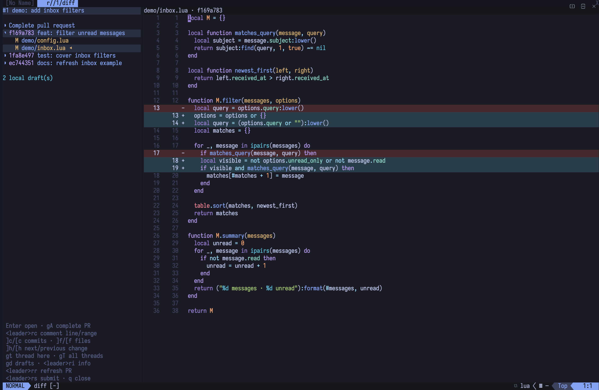

No checkout is needed. When Neovim's current repository matches the URL, the
plugin fetches the MR/PR head ref into `refs/review/<number>/head` in that repository. It
does not switch branches or change working files. Otherwise it fetches into a
bare repository in Neovim's cache directory.

The commit list and the comparison base come from the provider rather than a
possibly stale local `origin/main`. GitHub and Codeberg comparisons use the PR's
merge base.

### Commands

| Command | Action |
| --- | --- |
| `:Review [url]` | Open a GitLab MR, GitHub PR or Codeberg PR |
| `:ReviewNextCommit` / `:ReviewPrevCommit` | Next / previous commit |
| `:ReviewNextFile` / `:ReviewPrevFile` | Next / previous changed file |
| `:ReviewNextChange` / `:ReviewPrevChange` | Next / previous change block; counts supported |
| `:ReviewComplete` | Show the complete MR/PR comparison |
| `:ReviewPanel <action>` | Open or fold the selected panel entry |
| `:ReviewInfo` | Show the MR/PR title and Markdown description |
| `:ReviewHelp` | Search commands, configured mappings and their context in Telescope |
| `:ReviewPipelines` | Browse the GitLab MR's pipelines and jobs in Telescope |
| `:ReviewJobRefresh` | Reload the selected job's metadata and log in its Telescope picker |
| `:ReviewFiles [query]` | Focus the sidebar's live file filter, or apply a query |
| `:ReviewFilesClear` | Clear the sidebar filter and restore its directory folds |
| `:ReviewFilesPicker` | Search the current comparison's changed files in Telescope |
| `:ReviewViewed` | Mark the file under the cursor viewed locally |
| `:ReviewUnviewed` | Remove the file's local viewed marker |
| `:ReviewToggleViewed` | Toggle the file's local viewed marker |
| `:ReviewComment` | Compose a local draft on the current line |
| `:'<,'>ReviewComment` | Compose a local draft on a line range |
| `:ReviewReply` | Draft a reply to a discussion on the current diff line |
| `:ReviewOpenComment` | Open the comment under the cursor in the browser |
| `:ReviewDrafts` | Inspect, edit or delete local drafts |
| `:ReviewThreads` | Read all discussions and jump to their comment lines |
| `:ReviewThread` | Read discussions attached to the current diff line |
| `:ReviewJump` | Jump from a discussion window to the selected comment line |
| `:ReviewToggleComments` | Show or hide discussion messages and replies inline |
| `:ReviewRefresh` | Reload the review, commits, diffs and discussions |
| `:ReviewSubmit` | Preview drafts and choose whether to publish |
| `:ReviewApprove` | Approve the open MR/PR without submitting local drafts |
| `:ReviewRequestChanges` | Request changes on the open MR/PR without submitting local drafts |
| `:ReviewResolve` | Resolve the GitLab conversation under the cursor |
| `:ReviewResolveAll` | Warn and confirm before resolving all open GitLab MR conversations |
| `:ReviewClose` | Close the review tab |
| `:checkhealth review` | Check dependencies |

### Optional buffer mappings

**review.nvim does not define any mappings by default.** Every review shortcut
must be enabled explicitly in your Neovim configuration. Omitted keys and `false`
leave your existing mappings available. All enabled mappings are local to the
relevant review buffers.

Add this optional `keymaps` table to your existing `require("review").setup(...)`
call, or to your lazy.nvim plugin spec's `opts`. Keep only the shortcuts you want
and choose keys that fit your configuration:

```lua
require("review").setup({
  keymaps = {
    -- Panel and diff, normal mode.
    next_commit = "]c",
    prev_commit = "[c",
    next_file = "]f",
    prev_file = "[f",
    next_hunk = "]h",
    prev_hunk = "[h",
    complete = "<leader>ra",
    drafts = "<leader>rd",
    threads = "<leader>rT",
    submit = "<leader>rs",
    refresh = "<leader>rr",
    info = "<leader>ri",
    help = "<leader>r?",
    toggle_comments = "<leader>rt",
    toggle_viewed = "<leader>rv",
    files_picker = "<leader>rF",
    close = "q",

    -- Diff only; comment also works in visual mode.
    comment = "<leader>rc",
    reply = "<leader>rR",
    thread = "<leader>rl",
    open_comment = "<leader>ro", -- also in discussion windows

    -- Panel only.
    search_files = "<leader>rf",
    panel_open = "<CR>",
    panel_left = "h",
    panel_right = "l",
    panel_toggle = "za",
    panel_expand = "zo",
    panel_collapse = "zc",
    panel_collapse_all = "zM",
    panel_expand_all = "zR",
    filter_exit = "<Esc>", -- filter input, normal/insert: return to the tree

    -- Review document/comment windows.
    close_document = "q",
    select_comment = "<CR>", -- jump from a discussion to its diff line
    save_draft = "<C-s>",    -- comment editor, normal/insert mode

    -- Extra pipeline picker shortcuts, insert/normal mode.
    pipeline_open = "<C-o>",
    pipeline_back = "<C-b>",
    pipeline_refresh = "<C-r>",
  },
})
```

With that example enabled:

| Mapping | Action |
| --- | --- |
| `Enter` in the panel | Open a commit/file or toggle a directory |
| `h` / `l` in the panel | Collapse / expand directories or move to parent / first child |
| `za` / `zo` / `zc` in the panel | Toggle / expand / collapse a directory |
| `zM` / `zR` in the panel | Collapse / expand all directories |
| `<leader>rf` in the panel | Focus the live file filter |
| `<leader>rF` in the panel or diff | Search changed files in Telescope |
| `<Esc>` in the filter input | Return to the filtered tree |
| `<leader>rv` in the panel or diff | Toggle the file's local viewed marker |
| `]c` / `[c` | Next / previous commit |
| `]f` / `[f` | Next / previous file |
| `]h` / `[h` | Next / previous change block in the current file |
| `<leader>ra` | Complete MR/PR |
| `<leader>rc` in the diff, normal or visual mode | Comment on the line / range |
| `<leader>rR` in the diff | Draft a reply to a discussion on the current line |
| `<leader>ro` in the diff or discussion window | Open the comment in the browser |
| `<leader>rs` in the panel or diff | Preview drafts and choose whether to publish |
| `<leader>rr` in the panel or diff | Refresh the review |
| `<leader>ri` in the panel or diff | Show the MR/PR title and description |
| `<leader>r?` in the panel or diff | Open review help in Telescope |
| `<leader>rt` in the panel or diff | Toggle inline discussion messages and replies |
| `<leader>rd` | Local drafts |
| `<leader>rl` in the diff | Open discussions attached to the cursor line or range |
| `<leader>rT` | Open all discussions in the MR/PR |
| `q` | Close the review tab |

The panel uses your colorscheme for commits, directories and Git file statuses.
Highlight groups such as `ReviewHelp`, `ReviewFilterBorder`, `ReviewFilterPrompt`, `ReviewDirectory`, `ReviewFileAdded`,
`ReviewFileModified` and `ReviewFileDeleted` can be customized.

### Search review help

Run `:ReviewHelp` in an open review to browse commands and their configured
shortcuts in Telescope. Search by command, key, action or context. The preview
shows where an action applies; disabled mappings are shown as unconfigured.
GitLab pipeline and resolution commands appear for providers supporting them.

The optional example above binds `<leader>r?` through `keymaps.help`.
It defaults to `false`, like every other plugin mapping.
The sidebar contains the review information and tree; shortcut hints are shown
in this picker. Selecting a help entry closes the picker without executing
its action.

This command requires `telescope.nvim` and `plenary.nvim`.
The built-in `:help review.nvim` documentation is also available.

### Navigation

With the example mappings, `3]h` jumps forward three change blocks.
`:3ReviewNextChange` also works without mappings. A replacement's removed and
added lines form one block; navigation stays within the current file.
Use `:ReviewNextFile` for the next file.
Opening a file automatically places the cursor on its first change block,
opens any folds covering that line, and centers the diff view there.

### Directory tree

Changed files are grouped in nested, collapsible directories in the panel.
Directories appear first, then files, alphabetically within each level.
File rows show the basename, Git status and viewed marker; the full path remains
visible in the diff title and `:ReviewFilesPicker`.

With the optional example mappings, press `Enter` on a directory to toggle it.
`l` expands a closed directory or moves to its first child; on a file, it opens
the diff. `h` closes an expanded directory
or moves to the parent. `za`, `zo` and `zc` also toggle, expand and close directories.
Use `zM` to collapse all directories and `zR` to expand them.

Without mappings, use `:ReviewPanel open`, `left`, `right`, `toggle`, `expand`,
`collapse`, `collapse_all` or `expand_all`. The action applies to the panel entry
under the panel's cursor.

Directories start expanded. Their fold state is retained during the session for
each Git comparison, including when refreshing or switching between comparisons.
Selecting a file through search, next/previous file navigation or a discussion
jump expands its parent directories and reveals it in the panel. A collapsed directory containing
the displayed file shows `◀`.

### File filter in the sidebar

A search field sits below the MR/PR title, statuses and viewed progress,
immediately above the commit/file tree.
Its counter shows matching files / total files in the current Git comparison.
Run `:ReviewFiles` to focus it and type: the tree updates as you edit the query.
The diff stays open while filtering. The field follows its position above the
tree while scrolling, staying at the top once the review information scrolls
out of view.

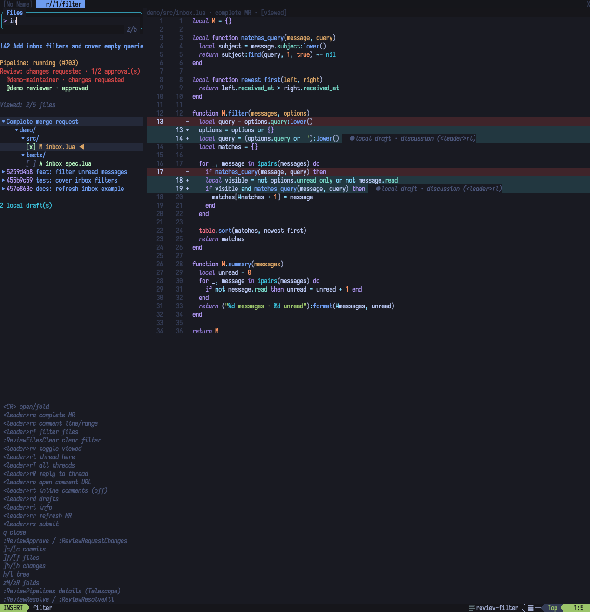

The query `in` keeps the source and test inbox files visible with their parent
directories, Git statuses and local viewed markers.
The screenshots retain the earlier placement of the field at the panel's top
and the shortcut list at the bottom; current shortcuts appear in `:ReviewHelp`.

Matching is case-insensitive and uses literal path fragments. All terms separated
by whitespace must match the new or old path, including renamed files.
For example, `transformation/` selects a directory's changed files, while
`transformation/ sql` narrows them to paths containing both fragments.
This filters changed files in the displayed commit or complete MR/PR comparison.

Only matching files and their parent directories remain in the tree. Matching
folders start expanded and can still be folded; their filter-specific fold state
is separate from the unfiltered tree. Git status colors, viewed markers and the
original file/commit references are preserved. A query with no matches shows an
empty-results message and leaves the current diff available.

The prompt's native `Enter` accepts the query and focuses the matching file in
the tree; `Ctrl-C` returns to the tree while keeping the filter.
Open a result with `:ReviewPanel open` or your configured panel mapping.
An optional `keymaps.filter_exit` can also return to the tree.

| Command | Action |
| --- | --- |
| `:ReviewFiles` | Focus the input and edit the query |
| `:ReviewFiles transformation/` | Apply a query without focusing the input |
| `:ReviewFilesClear` | Clear the query and restore the original directory folds |

The query stays active across commits and refreshes; the counter follows the
displayed comparison. Next/previous file navigation skips files hidden by the
filter. Configure `keymaps.search_files` to enable a panel shortcut; it defaults
to `false`. The sidebar filter needs no picker dependency.

### File search in Telescope

Run `:ReviewFilesPicker` to search all changed files in the current comparison,
including ones hidden by the sidebar filter. Telescope searches both old and new
paths. Its selection action opens the chosen review diff and updates the panel;
choosing a hidden file clears the sidebar filter to reveal it.
Added, modified, deleted, renamed and copied files are marked `A`, `M`, `D`, `R` and `C`.

The picker uses the review's Git comparison rather than files from the working
directory. If that comparison changes, reopen the picker before selecting a file.
Configure `keymaps.files_picker` to enable a shortcut; it defaults to `false`.
This command requires `telescope.nvim` and `plenary.nvim`.

### Viewed files

Use `:ReviewViewed` to mark the file under the cursor in the panel, or the file
displayed in the diff. Use `:ReviewUnviewed` to remove the marker.
`:ReviewToggleViewed` switches between the two states.
Opening a file leaves its viewed state unchanged.

The panel and `:ReviewFilesPicker` display `[x]` for viewed files and `[ ]` for unviewed
files. The panel also shows `Viewed: N/M files` for the current comparison, and
the diff's title shows `[viewed]` or `[unviewed]`. Customize `ReviewFileViewed`
to change the viewed marker's color.

Progress is stored locally under `state_dir/viewed/`, separately for each MR/PR
and exact Git comparison (base, head, old/new paths and file status). Reopening
the same comparison restores its markers. Individual commits and the complete
MR/PR have separate progress; a new comparison starts unviewed. Returning to a
previous comparison restores its own progress.

These commands work with all supported providers and only update local progress.
Configure `keymaps.toggle_viewed` to enable a shortcut; it defaults to `false`.
If the state file cannot be read, the review remains
available and markers display `[?]`; an invalid file is preserved. Failed saves
leave the displayed state unchanged. `:ReviewRefresh` reloads local progress.

### Review title and description

Run `:ReviewInfo` to read the review's title and description in a read-only
Markdown window. Use `:q` to close it.
An empty description displays "No description provided."

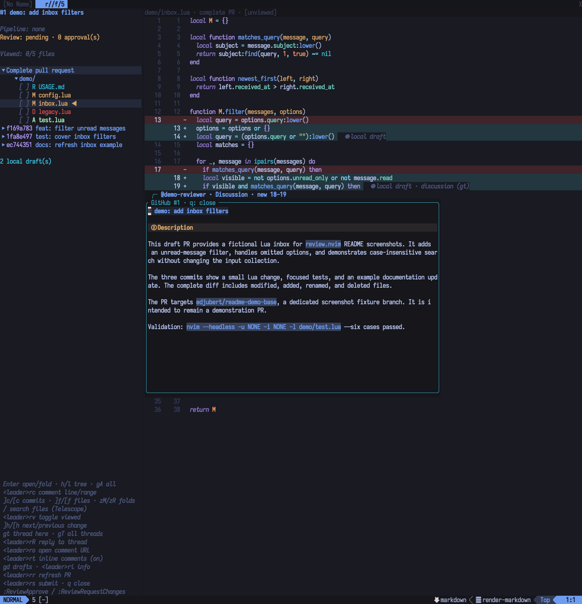

The window uses the loaded review metadata. Run `:ReviewRefresh` to retrieve
changes made to the title or description since the review was opened.
Configure `keymaps.info` to enable a shortcut; it defaults to `false`.

### Refresh a review

Run `:ReviewRefresh` to fetch the latest MR/PR metadata, commits, diffs and
discussions in the existing tab.
The current commit and file stay selected when they still exist. If a rebase
replaced the selected commit, the complete MR/PR view opens instead. The cursor
position is retained when the displayed Git revisions are unchanged.

Local drafts keep their original positions. If the review diff changed, publication
still requires choosing updated positions. A failed refresh keeps the previously
loaded review available, and the command can also retry a failed initial load.

### Pipeline and review status

The panel shows the latest MR pipeline on GitLab, commit statuses and check runs
on GitHub, and commit statuses on Codeberg. It also shows approvals, change
requests and each reviewer's decision. GitLab includes its required approval
count; GitHub and Codeberg show received decisions, which do not guarantee that
all branch protection requirements are satisfied.

Statuses are read when opening or refreshing a review and after submitting a
decision or comments. Run `:ReviewRefresh` to fetch changes made on the server.
Unavailable status endpoints display `unavailable` while the diff stays readable.

### Pipeline details in Telescope

Run `:ReviewPipelines` in an open GitLab MR. The picker lists all pipelines attached
to that MR, newest first, with status, source, commit, ref and creation date.
Its preview loads the selected pipeline's jobs and downstream triggers
asynchronously, including stage, status, duration and failure reason. It also
indicates whether the pipeline matches the MR head revision loaded in your review.

Jobs are grouped under bold stage headings, with the stage name shown once.
Each job shows an icon, its name, status and duration. Pipeline and job rows,
preview status fields and job lines use these colors:

| State | Color |
| --- | --- |
| Success | Green |
| Failed / error | Red |
| Pending / queued / waiting for resources / scheduled | Orange |
| Running / preparing | Blue |
| Created / manual / skipped / canceled / unknown | Grey |

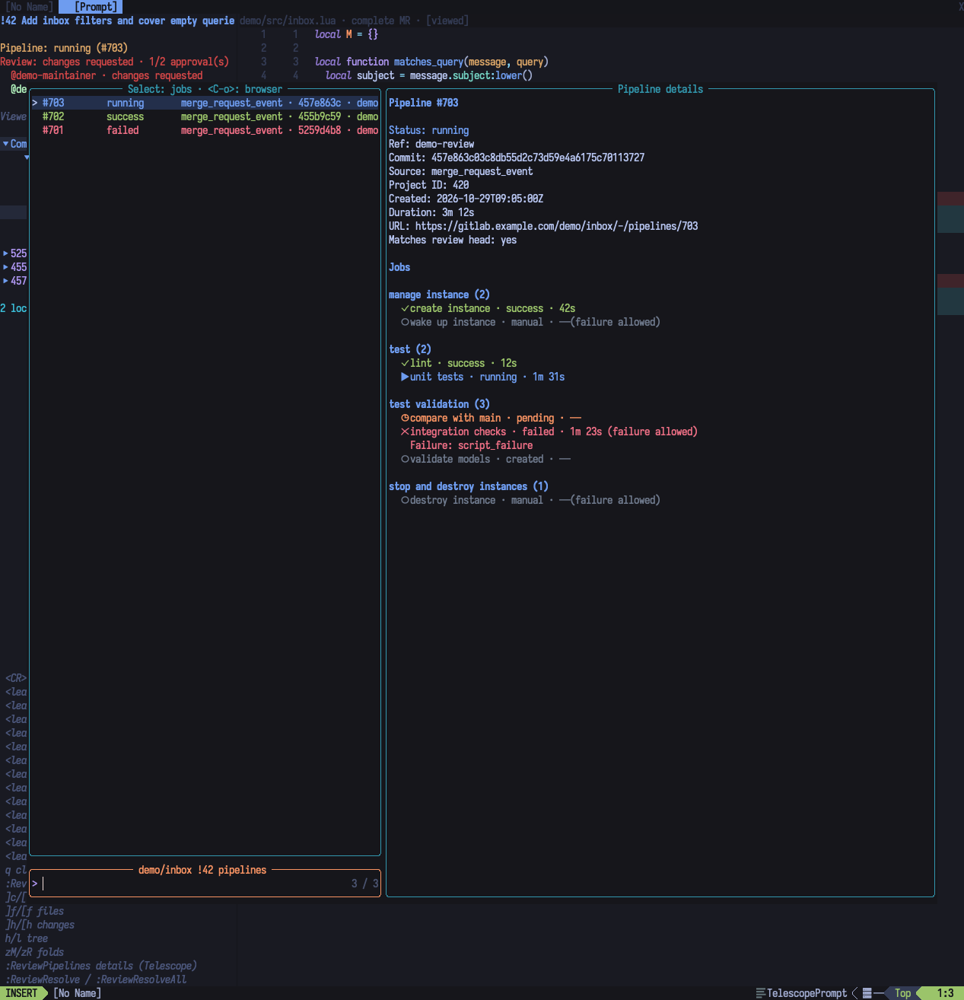

`:ReviewPipelines` previews the selected pipeline's jobs beneath their stage
headings, with colors reflecting each job's status.

Customize `ReviewPipelineSuccess`, `ReviewPipelineError`, `ReviewPipelinePending`,
`ReviewPipelineRunning`, `ReviewPipelineInactive` and `ReviewPipelineStage`
to change these colors and stage headings.

| Picker | Key | Action |
| --- | --- | --- |
| Pipelines | Telescope's selection action | Browse the selected pipeline's jobs |
| Jobs | Telescope's selection action | Open the selected job in GitLab |
| Pipelines or jobs | Optional `keymaps.pipeline_open` | Open the selected pipeline or job in GitLab |
| Jobs | Optional `keymaps.pipeline_back` | Return to the pipeline list |
| Jobs | `:ReviewJobRefresh` or optional `keymaps.pipeline_refresh` (`<C-r>` in the example) | Reload the selected job's metadata and log, bypassing the cache |

Telescope's selection variants (default, split, tab and drop) all perform the
picker action above. Custom selection bindings are supported; pipeline and job
entries are never treated as local file paths.

Selecting a pipeline opens a searchable jobs picker with non-selectable stage
headings. Stages follow their first occurrence in the pipeline's job list; jobs
are sorted by name within each stage. Searching filters jobs without rearranging
their groups. Each job row uses its status color.

Highlight a job to load its log asynchronously in the preview. Above the log,
the header shows its name, ID, status, stage, triggering user, ref, commit,
creation/start/finish dates, execution and queue durations, runner, failure
policy and failure reason when available. Use Telescope's usual search and
preview scrolling keys. Once loaded, the preview scrolls to the end of the log;
scroll upward to read earlier output or its metadata header.

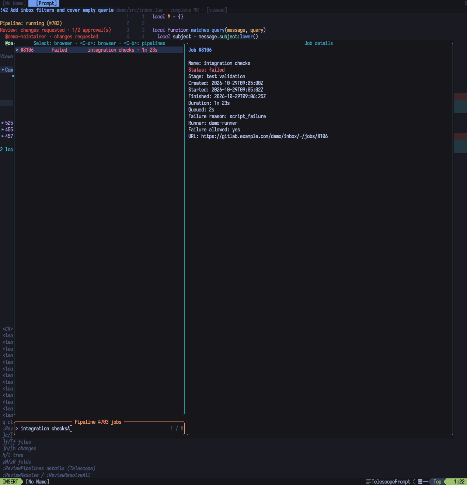

Selecting a pipeline opens its jobs picker. The preview here shows the failed
`integration checks` job and its timings, runner and failure policy.
This earlier capture shows the metadata view; the current preview includes the
job log beneath it.

The command requires `telescope.nvim` and `plenary.nvim`; the rest of the plugin
works without them. With lazy.nvim, you can add
`dependencies = { "nvim-telescope/telescope.nvim" }` to the review plugin spec,
and configure Telescope's own `plenary.nvim` dependency as usual.
Each command invocation fetches a fresh list; details are cached only while
browsing that list. Completed job previews are reused; reselecting a job that
has not finished reloads its details and log after a three-second cache interval.
Logs do not poll in the background. Late responses never replace another job's
preview or update a closed picker. Run `:ReviewJobRefresh` from the jobs picker
or its preview to reload the selected job's details and log immediately, including
completed jobs. The optional example uses `<C-r>` in normal and insert mode.
An already pending load is kept instead of starting a duplicate request.
After refreshing, the preview scrolls to the latest output.

Logs keep their ANSI foreground/background colors (16-color, 256-color and RGB),
bold, italic, underline, inverse and strikethrough styling. The first 16 colors
use Neovim's `terminal_color_0` through `terminal_color_15` when configured.
Other terminal control sequences and GitLab section markers are removed.
The preview remains an ordinary read-only buffer. Very long logs show their tail,
limited to 5,000 lines and 512 KiB, with a truncation notice. The browser link opens
the full log.
Empty, erased or inaccessible logs show a message while retaining job metadata.
Downstream triggers show their downstream pipeline metadata and link, since
they have no job trace.

An unavailable jobs or triggers endpoint is reported in the preview. The command
only reads GitLab APIs and does not run, retry or cancel jobs.
Pipeline details for GitHub and Codeberg are not implemented.

## Comments

1. Put the cursor on a line, or select a range with `V`.
2. Run `:ReviewComment`, or `:'<,'>ReviewComment` for a visual selection.
3. Write the comment in the Markdown editor.
4. Use `:w` to **save locally**. `:q!` cancels.
5. Inspect drafts with `:ReviewDrafts`.
6. Run `:ReviewSubmit`, inspect the preview, then explicitly
   select publication.

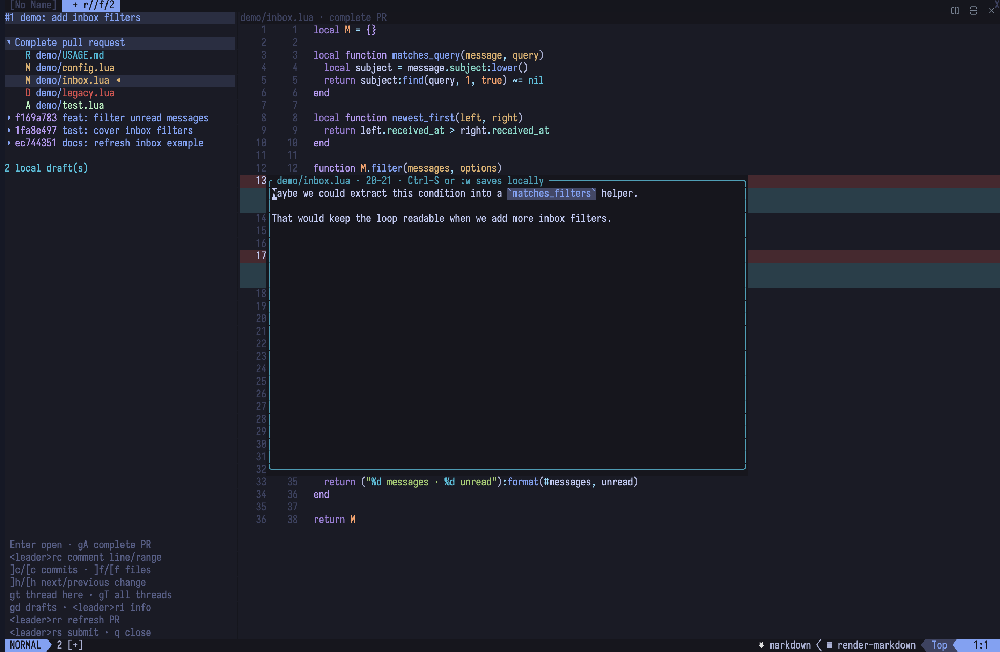

Creating, saving or opening a draft never posts it to the provider.
Saving writes the draft to disk, exits insertion and closes the comment editor.
The draft remains available after a restart; publication requires `:ReviewSubmit`.
Set `keymaps.save_draft` to enable a save shortcut and `keymaps.close_document`
to enable a close/cancel shortcut.

Drafts survive Neovim restarts, under `stdpath("state")/review/drafts/`.
Before publication, the plugin checks that the review's diff refs still match each
draft. If the MR/PR changed, it preserves the draft and asks for an updated position.
It records each successful post before proceeding to the next comment.
If a request's outcome is uncertain, it blocks automatic retry: inspect the provider
and use `:ReviewDrafts` to delete the draft or authorize a retry.

### Manage local drafts

Run `:ReviewDrafts` to select a saved draft, then choose
`Edit locally` or `Delete locally`.

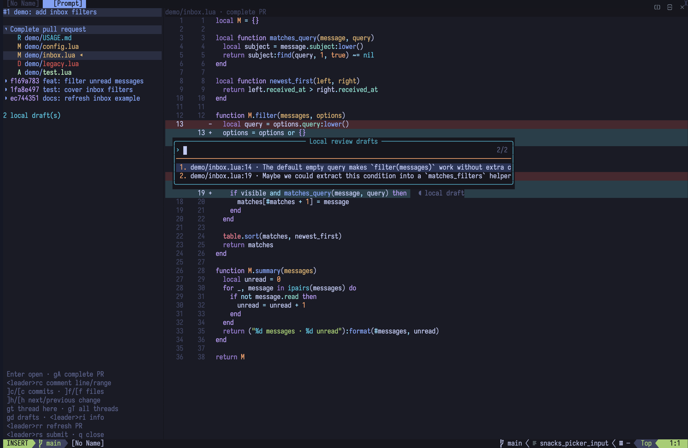

### Preview before publication

`:ReviewSubmit` opens a preview and asks whether to keep the drafts local or
publish them. Choose `Keep local` to retain them without posting, publish comments
only, or publish them **and request changes**. The combined action requests changes
only after every comment has been confirmed. If a comment fails, the change
request is not sent and the remaining drafts stay local.

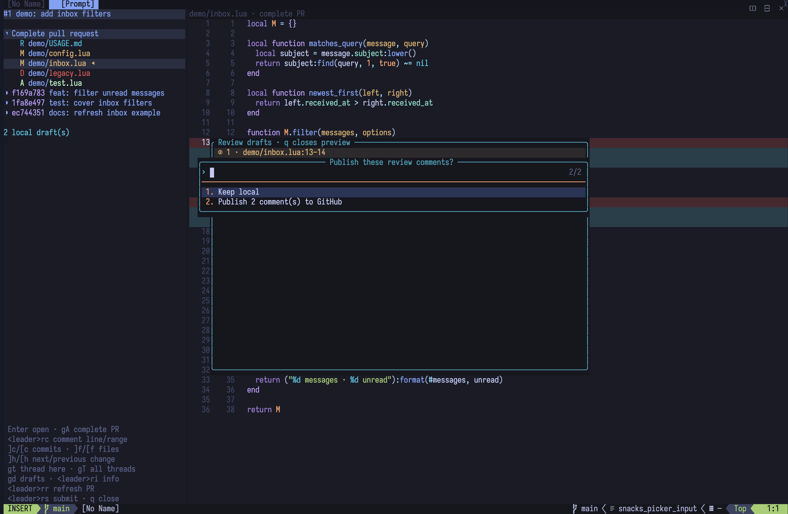

### Approve or request changes

Run `:ReviewApprove` to approve the MR/PR in the current session. Approval is sent
immediately and requires the corresponding provider permission.

Run `:ReviewRequestChanges` to request changes without publishing local drafts.
The command asks for confirmation; GitHub and Codeberg also require a review
summary. This action updates the remote review decision and does not push Git
commits. The combined `:ReviewSubmit` action asks for the same summary when needed.

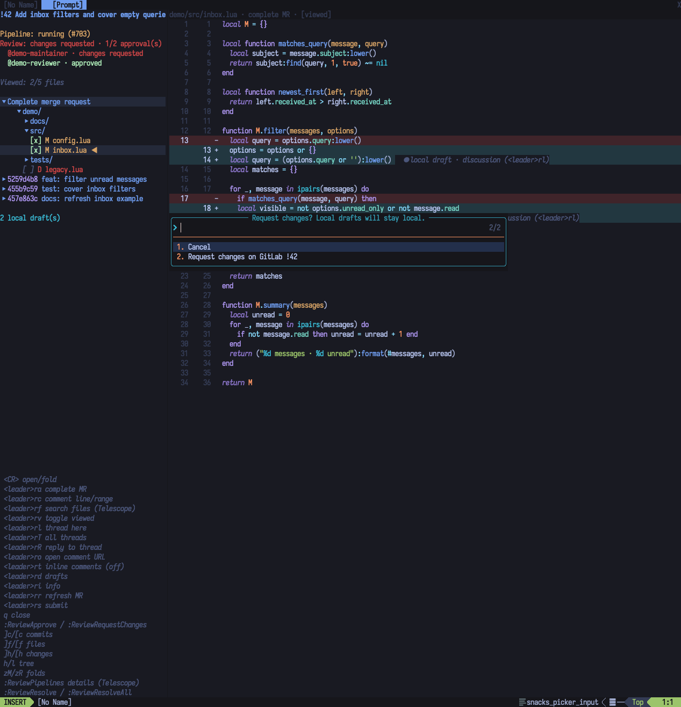

`:ReviewRequestChanges` confirms the standalone decision while preserving local
drafts. The simulated MR also shows each reviewer's decision in the sidebar.

Both actions check that the loaded review revision is still current. If it
changed, run `:ReviewRefresh` and inspect the new diff first. GitLab uses the
native `mergeRequestRequestChanges` GraphQL mutation. Older servers that do not
expose it reject the action before the combined flow publishes comments. GitLab
may also require you to be assigned as a reviewer; whether requesting changes
blocks merging depends on the server's version, tier and project configuration.

If comments were published but the change request could not be confirmed, those
comments are not republished. Inspect the remote decision before retrying with
`:ReviewRequestChanges`.

### Browse discussions

Use `:ReviewThread` on a commented diff line to open its discussion. For a range
comment, any line inside the range works. If several discussions share that line, they
open together. In commit views, current-review discussions are mapped onto
unchanged lines; ranges must remain contiguous and unchanged.

Use `:ReviewThreads` to read all discussions across
the MR/PR, including comments without a file position.

Discussion messages and replies display emoji shortcodes such as `:thinking:`
and `:question:` as 🤔 and ❓, both inline and in the discussion window.
The bundled [gemoji](https://github.com/github/gemoji) Unicode catalogue works
offline. Unknown shortcodes, escaped shortcodes, Markdown code spans and fenced
code blocks stay literal. Draft editing and submission previews keep the
original text.

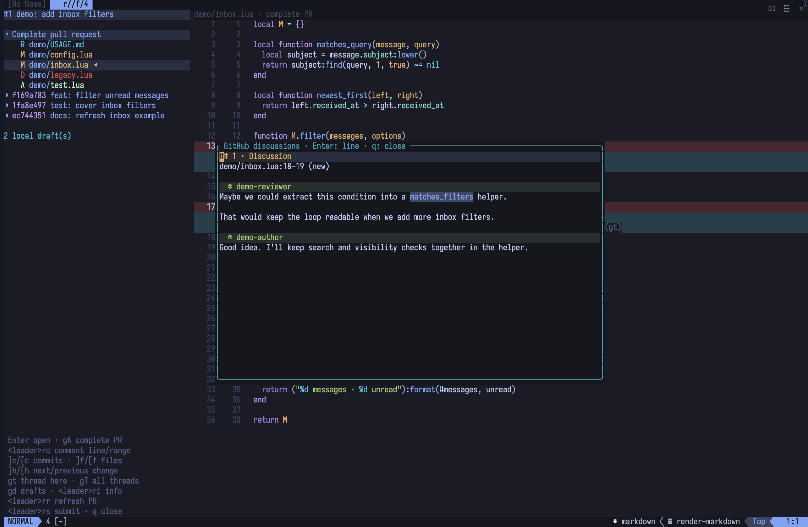

The simulated conversation shows its resolved state and each message's emoji
reactions, including the users behind those reactions.

In the discussion window:

| Command / key | Action |
| --- | --- |
| `j` / `k` | Move through discussions and replies |
| `:ReviewJump` | Jump to the selected discussion's comment line |
| `:ReviewOpenComment` | Open the selected comment or reply in the browser |
| `:q` | Close the window |

`:ReviewJump` works on a discussion's heading, location or message text. It focuses
the line in the displayed diff when available. Otherwise it opens the file in the
complete MR/PR view, focuses the commented side (including deleted lines), opens
any folds and centers the cursor.

For an older comment, the plugin maps unchanged lines to the current review.
If its line was rewritten/deleted, its file is no longer in the review diff, or
the provider does not expose its original revision, the discussion stays open
with an explanatory message. Comments without a file line remain readable.

### Open a comment in the browser

Run `:ReviewOpenComment` on a commented diff line.
Any line inside a comment range works; if several discussions cover the line,
choose which one to open. The browser opens the discussion's root comment.

In a discussion window (`:ReviewThread` or `:ReviewThreads`), the same command
opens the comment or reply under the cursor. Discussion headings and
file locations open the root comment. General, resolved and outdated comments
can also be opened when their URL is available.

The plugin uses GitLab note links and the comment URLs returned by GitHub and
Codeberg, opening them with Neovim's `vim.ui.open` and the system's default
browser. If a comment has no URL or the browser cannot be launched, a message
explains why. Local drafts have no published URL.
Configure `keymaps.open_comment` to enable a shortcut; it defaults to `false`.

### Comment reactions

Reactions appear below each comment and reply in inline discussions and
`:ReviewThreads`, for example `Reactions: 👍 2 · ❤️ 1`. Discussion windows also
show who reacted when the provider exposes this information.

GitLab reads note emoji awards; GitHub exposes reaction counts on review comments;
Codeberg reads comment reactions. These are read-only operations. Reactions are
reloaded with discussions by `:ReviewRefresh`. If a reaction endpoint fails, the
comment stays readable and shows `Reactions unavailable`.

### Resolve GitLab conversations

Run `:ReviewResolve` on a commented diff line or anywhere in a conversation opened
with `:ReviewThread` or `:ReviewThreads`. A command on a reply resolves the entire
conversation. If several conversations cover the selected diff line, choose
which one to resolve. Already resolved and non-resolvable conversations are skipped.
The action is sent immediately after selecting the conversation.

Run `:ReviewResolveAll` from the open MR session to resolve every currently
unresolved, resolvable GitLab conversation, including outdated ones. A warning
dialog shows the count and MR number; **Cancel** is the first/default choice.
Confirm explicitly to continue. Newly created conversations after the warning
are not included.

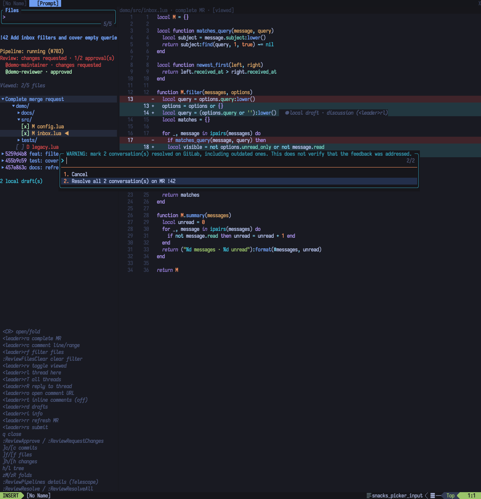

`:ReviewResolveAll` shows the count and warns that marking conversations resolved
does not verify that their feedback was addressed.

Both commands use GitLab's native discussion resolution API and require the
corresponding permission. They check the MR revision and reread each conversation
before writing. New or edited comments stop resolution so you can refresh and
read the changes. Local drafts stay local.

Each confirmed resolution is kept visible in the diff and open discussion
windows. If an API request fails, processing stops; earlier confirmed resolutions
are retained and the remaining conversations are left alone. Check GitLab before
retrying if a request's outcome could not be confirmed. GitHub and Codeberg
conversation resolution is not implemented.

### Inline discussions

Run `:ReviewToggleComments` to show or hide discussions
directly below their commented lines. A range discussion appears below its last
line, with the author, message and replies. Multiple discussions on the same line
appear together.

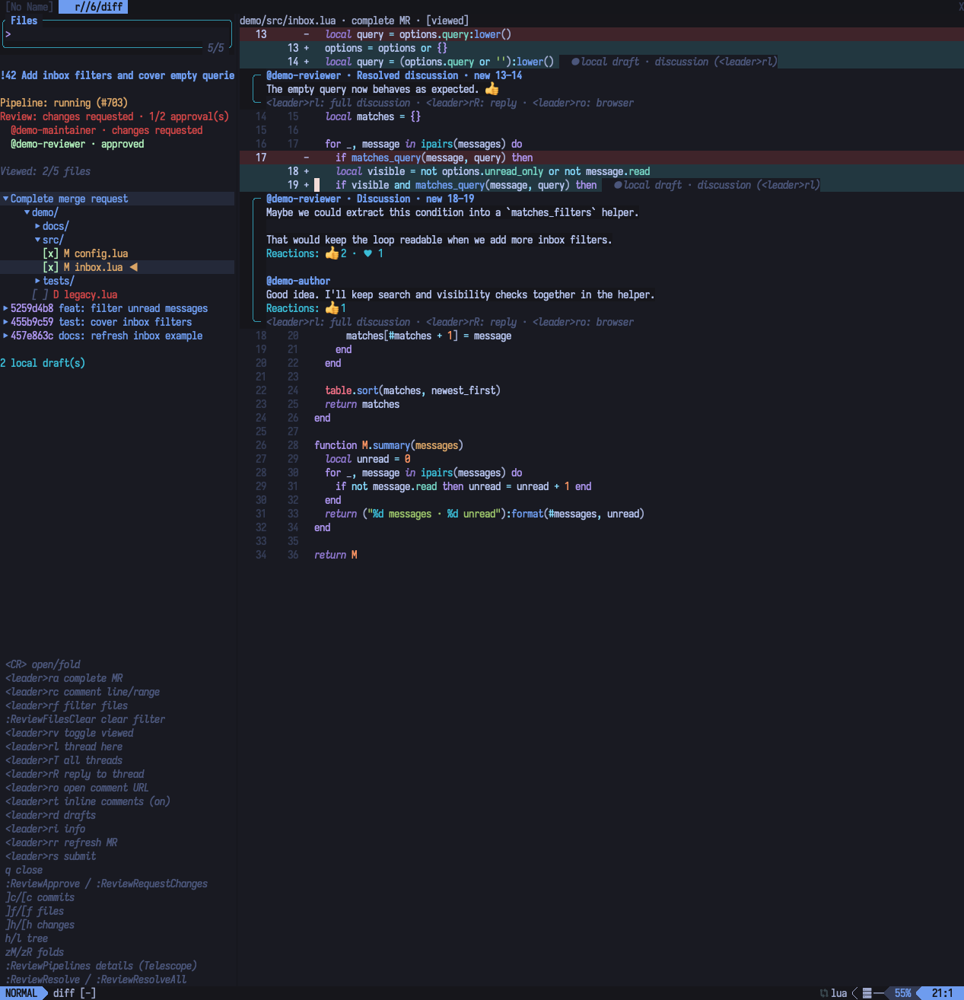

`:ReviewToggleComments` shows the discussion beneath its diff anchor. With the
optional mapping example above, `<leader>rt` toggles this display.

Messages use virtual lines, leaving the diff content and comment positions
unchanged. Long lines wrap to the diff window's width. Markdown is displayed as
text; use `:ReviewThread` to open the complete discussion in a Markdown window.

Inline discussions are hidden by default. Set `inline_comments = true` to show
them when opening a review. The toggle applies to the current review and survives
file/commit navigation and refreshes. Configure `keymaps.toggle_comments` to
enable a shortcut; it defaults to `false`.

Only discussions that can be mapped to the displayed diff appear inline.
General comments and discussions on unavailable lines remain accessible with
`:ReviewThreads`. Local drafts keep their compact markers.
Customize `ReviewCommentBorder`, `ReviewCommentAuthor`, `ReviewCommentBody` and `ReviewCommentReaction`
to change the blocks' colors.

### Reply to a discussion

Put the cursor on a commented diff line and run `:ReviewReply`.
Any line inside a comment range works. If several discussions cover
the line, select the one you want to answer.

The Markdown editor creates a persistent **local reply draft**. `:w`
saves it locally; `:q!` cancels. `:ReviewDrafts` lets you edit or delete it, and the
diff marks it as `local reply`. `:ReviewSubmit` previews the original comment and
your reply, then asks for explicit publication.

Replies use the existing discussion ID, preserving the thread instead of creating
a new inline comment. Before publication, the plugin checks the diff refs and
that the original comment still exists. Failed or uncertain requests keep the
draft, with the same retry safeguards as new comments.

| Provider | Replies |
| --- | --- |
| GitLab | Adds a note to the existing MR discussion |
| GitHub | Replies to the top-level PR review comment |
| Codeberg | Reply drafts are not supported by this provider |

Replies leave approval and resolution unchanged. Configure `keymaps.reply` to
enable a shortcut; it defaults to `false`.

### Line positions in commit views

A comment written in a commit view is attached to the current **MR/PR discussion**.
The plugin maps the selected commit's lines to the current review diff. This lets
comments on an early commit appear in the MR/PR when subsequent commits left those
lines unchanged.

If later commits rewrote or removed a selected line, its position is ambiguous;
use `:ReviewComplete` to choose a line in the complete MR/PR. Providers require
a line to be inside its diff hunks. Lines outside that context remain readable but cannot
receive an inline discussion.

Ranges must be contiguous on one side of the diff. Select additions or deletions
separately when a replacement contains both.

GitLab's discussion card can show up to 16 diff lines ending at the comment's
last line, even for a shorter selection. The range shown below that excerpt is
the actual comment range. The discussion API does not expose a context-size option.

On GitHub, selections become review comments with `line` and `side` (`LEFT`
for deleted lines, `RIGHT` for added/current lines). Ranges also include
`start_line` and `start_side`. Each submitted draft creates one published
review comment. Publishing comments alone leaves the review decision unchanged;
the combined submission then sends a separate `REQUEST_CHANGES` review.

On Codeberg, each draft creates a Forgejo review with the `COMMENT` event.
The first selected line is sent as `old_position` or `new_position`; ranges use
`extra_lines_count` for the following lines. Publishing comments alone leaves the
review decision unchanged; the combined submission then sends a separate
`REQUEST_CHANGES` review.

Codeberg can include existing browser drafts when submitting a review. The plugin
checks for a pending review before sending each draft and leaves its local drafts
saved if one exists. Finish or discard that pending review on Codeberg first.

## Configuration

```lua
require("review").setup({
  panel_width = 44,
  inline_comments = false, -- initially show only discussion markers
  keymaps = {},           -- all shortcuts disabled; see Optional buffer mappings
  clone_protocol = "ssh", -- or "https"; uses existing Git credentials
  repo = nil,            -- optional repository path; otherwise auto-detected
  cache_dir = vim.fn.stdpath("cache") .. "/review",
  state_dir = vim.fn.stdpath("state") .. "/review",
})
```

## Current scope

- GitLab and GitHub, including their self-hosted instances, plus `codeberg.org`.
  Other Forgejo/Gitea hosts are not supported by the Codeberg provider.
- Text files; binary files display a notice.
- Commit diffs compare against the first parent. Root commits are not supported.
- Pipeline/check status, approval and change requests on all providers.
- Live file filtering in the sidebar on all providers, without a picker dependency.
- Command help, GitLab pipeline/job details and a separate file picker via optional Telescope.
- Local viewed/unviewed progress on all providers, scoped to each Git comparison.
- Discussion reading and new comments on all providers; replies on GitLab and
  GitHub. Conversation resolution on GitLab. Codeberg reply drafts and GitHub/
  Codeberg conversation resolution are not implemented.
- The provider must expose the file's diff to accept a positional comment.
- GitHub's files API exposes at most 3000 changed files. Larger PRs are rejected
  instead of presenting an incomplete review. Commit lists above 250 entries
  use the paginated comparison API and must match the PR's commit count.
- GitHub discussions use the REST review-comments API. Outdated comments are
  labeled; the resolved/unresolved state is not exposed by this API.
- Codeberg paginates commits, files and reviews using the server's page size and
  result counts. Inline positions come from the PR's full raw diff.
- Codeberg displays review comments individually, including resolved/stale
  indicators when exposed by the API. Comments whose commit cannot be matched
  to the current diff remain readable in `:ReviewThreads` without an inline marker.
- The inline view contains selectable deleted lines; it does not depend on
  `diffview.nvim` or `inline-diff.nvim`.

## Development

```sh
nvim --headless -u NONE -i NONE -l tests/run.lua
```

The suite checks line mappings, positions, persistence, Git snapshot loading,
status aggregation and publication/decision behavior with mocked transports. It never posts comments to
a real service.

An optional integration check reads a real MR/PR, renders every commit/file view,
and saves one comment as a temporary local draft. Its transport rejects writes:

```sh
nvim --headless -u NONE -i NONE -l tests/smoke_read.lua \
  https://gitlab.example.com/group/project/-/merge_requests/123 \
  /path/to/local/repository
```
